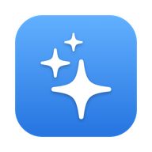
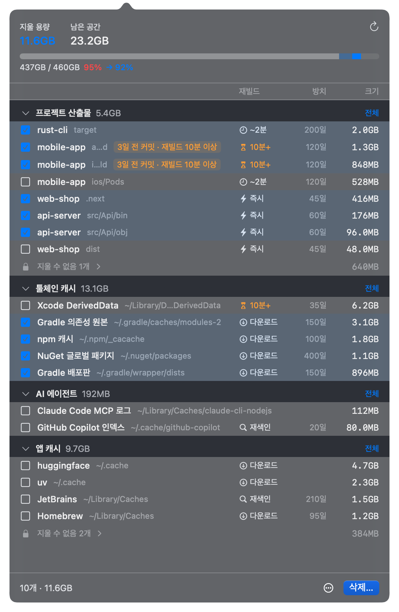
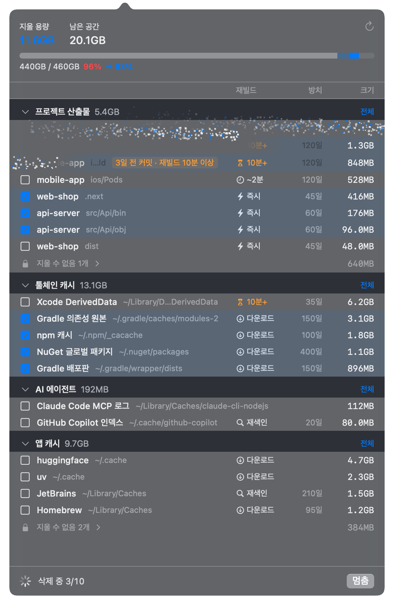
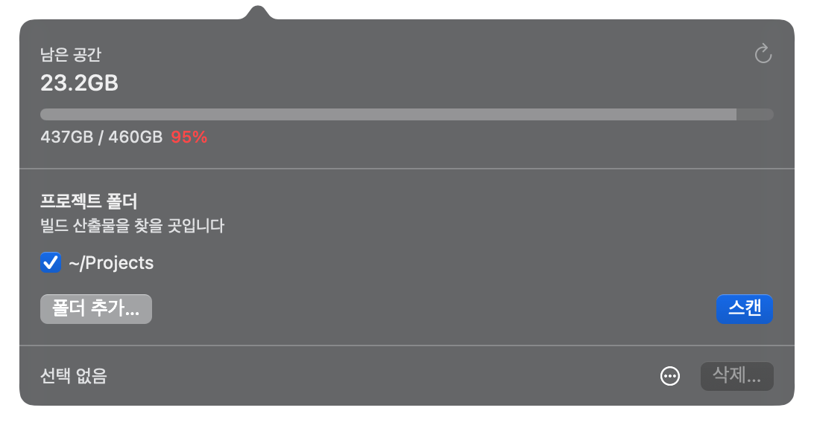
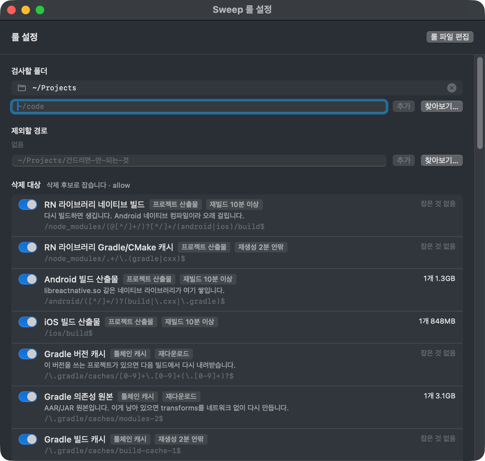

<div align="center">
  

  <h1>Sweep</h1>

  <p><b>빌드 산출물과 캐시를 골라서 지우는 macOS 메뉴바 앱</b></p>

  <p><a href="README.md">English</a> · 한국어</p>

  <p>
    
    
    
  </p>
</div>

<table>
  <tr>
    <td></td>
    <td></td>
  </tr>
</table>

디스크가 꽉 찼을 때 용량은 쉽게 알 수 있습니다. 어려운 건 지우고 나면 무엇을 다시 해야 하는지 모른다는 점입니다. Sweep은 후보마다 다시 만드는 데 드는 비용을 붙여서 보여주고, 무엇을 지울지는 직접 고르게 합니다.

Xcode DerivedData, Gradle과 npm 캐시, NuGet 패키지, Rust `target`, `.next`, `.build`를 비롯해 프로젝트 안의 빌드 폴더를 찾습니다. 전체 목록은 [룰 레퍼런스](docs/rules.md)에 있습니다.

## 설치

macOS 14 이상과 Swift 6.0 이상 툴체인이 필요합니다.

```bash
git clone git@github.com:Bigide19/sweep.git
cd sweep/app
./scripts/build-app.sh --install
```

`/Applications/Sweep.app`으로 설치됩니다. 설치하지 않고 바로 띄우려면 `--install` 대신 `--run`을 붙입니다.

## 하는 일

- **다시 만드는 비용을 보여줍니다.** 후보마다 즉시 재빌드, 2분 안팎, 10분 이상, 재다운로드 중 하나가 붙습니다. 같은 1GB라도 지우는 부담이 다릅니다.
- **오래 방치한 것부터 고릅니다.** 마지막으로 수정한 지 며칠이 지났는지 보고 기본 선택을 정합니다. 어제 받은 npm 캐시와 1년 묵은 빌드를 같이 취급하지 않습니다.
- **실제 상태를 보고 지워도 되는지 확인합니다.** `build`라는 이름만으로는 산출물인지 직접 쓴 파일인지 알 수 없습니다. 그래서 git이 추적하는 경로, 커밋하지 않은 변경이 든 폴더, 사용 중인 캐시는 막습니다.
- **모르는 것은 건드리지 않습니다.** `~/Library/Caches`에서 목록에 없는 항목은 크기만 보여주고 잠급니다.

<details>
<summary>안전 검사 9가지 전체 보기</summary>

| 검사 | 결과 |
|---|---|
| git이 추적하는 경로 | 차단 |
| 커밋하지 않은 변경이 들어 있음 | 차단 |
| 그 캐시를 쓰는 프로세스가 실행 중 | 차단 |
| 실행 중인 Sweep 자신이 들어 있음 | 차단 |
| git으로 받은 SDK(Homebrew, Flutter 등) 안 | 차단 |
| git 명령 실패, 명령줄 도구 없음 | 차단 |
| 그 버전을 쓰는 프로젝트가 있음 | 경고, 기본 선택 해제 |
| git 저장소 밖의 빌드 산출물 | 경고, 기본 선택 해제 |
| 최근에 커밋한 프로젝트 | 경고. 재빌드가 오래 걸리는 것만 |

`dist`와 `Pods`는 손으로 관리하는 폴더일 수 있어서 미리 체크하지 않습니다.

</details>

## 사용법

메뉴바 아이콘을 누르면 패널이 열립니다. 아이콘 옆에는 디스크 사용률과 정리할 수 있는 용량이 표시됩니다.

**1. 프로젝트 폴더를 확인합니다.** 처음 열면 홈 아래에서 git 저장소가 모인 폴더를 찾아 제안합니다. 빠진 폴더는 직접 추가합니다. Desktop, Documents, Downloads는 macOS가 보호하는 폴더라서 자동으로 찾지 않습니다.



**2. 지울 것을 고릅니다.** 스캔이 끝나면 일부 항목이 미리 체크되어 있습니다. 얼마나 적극적으로 체크할지는 `⋯` 메뉴에서 정합니다.

| 단계 | 미리 체크하는 대상 |
|---|---|
| 최소 | 빌드 산출물 |
| 표준 | 빌드 산출물, 90일 넘게 안 쓴 툴체인 캐시 |
| 최대 | 빌드 산출물, 30일 넘은 툴체인 캐시, 90일 넘은 앱 캐시 |

**3. 삭제합니다.** 지운 줄부터 목록에서 사라지고, 도중에 멈출 수 있습니다.

> [!WARNING]
> 삭제는 되돌릴 수 없습니다. 휴지통에 넣으면 디스크 용량이 그대로라서 바로 지웁니다. 지운 기록은 `~/Library/Application Support/Sweep/history.jsonl`에 남습니다.

랜섬웨어 방어 프로그램이 삭제를 막으면 허용 창에서 허용하면 됩니다. 막힌 항목이 있으면 패널에 그 파일 이름과 남은 용량이 표시됩니다.

검사할 폴더와 제외할 경로, 룰마다 켜고 끄는 설정은 `⋯` 메뉴의 룰 설정 창에서 바꿉니다. 화면 언어(한국어, English)도 같은 메뉴에 있습니다.



<details>
<summary>CLI</summary>

```bash
cd app && swift build -c release

.build/release/sweep scan          # 후보 목록
.build/release/sweep clean --yes   # 기본 선택된 후보 삭제
.build/release/sweep rules         # 적용 중인 룰
.build/release/sweep history       # 삭제 이력
.build/release/sweep verify        # 룰 회귀 검증
```

</details>

## 문서와 라이선스

설계 배경은 [docs/architecture.md](docs/architecture.md), 룰 목록은 [docs/rules.md](docs/rules.md)에 있습니다. MIT License로 배포합니다([LICENSE](LICENSE)).
