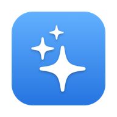
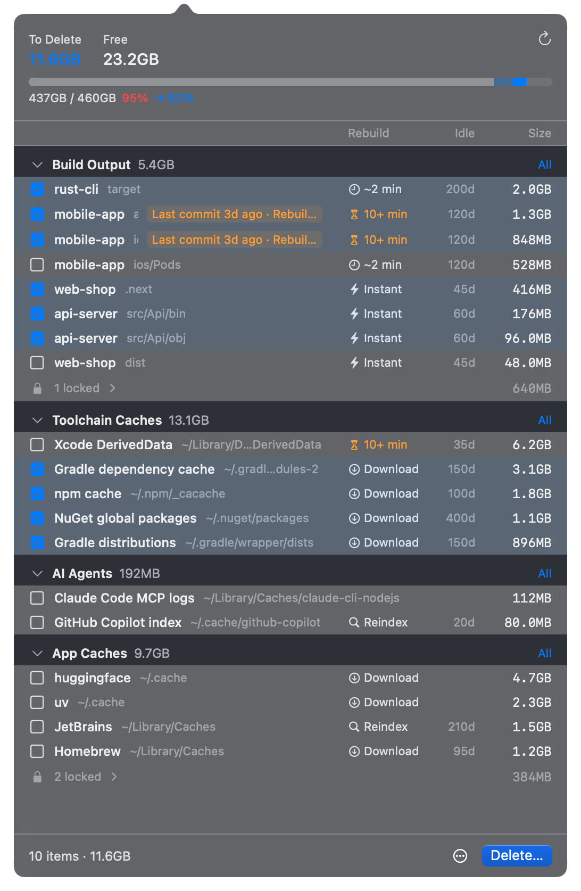
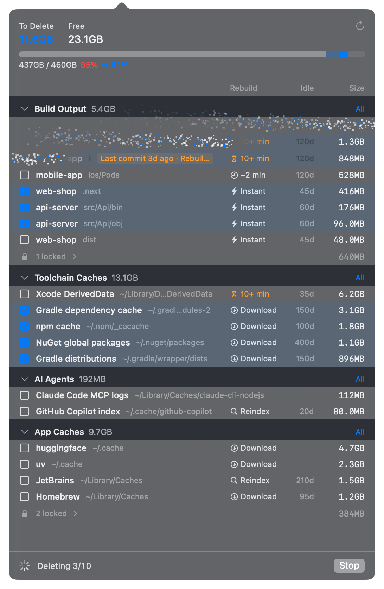
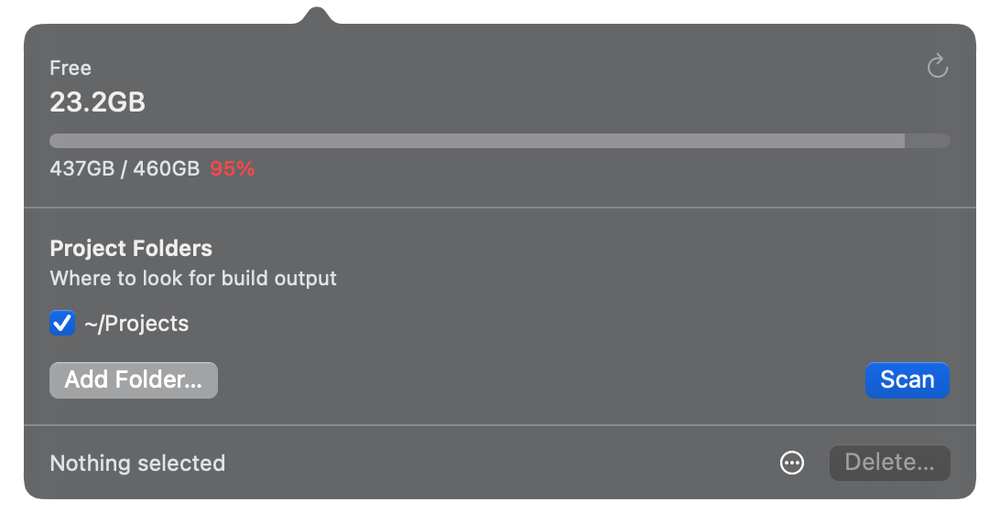
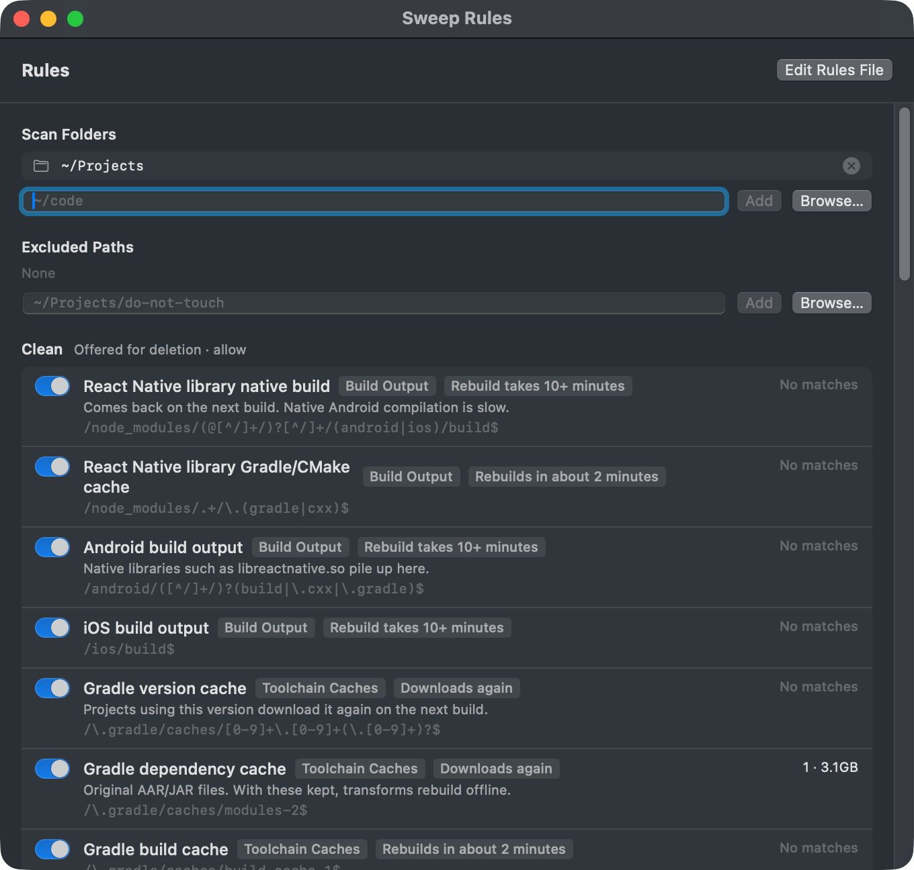

<div align="center">
  

  <h1>Sweep</h1>

  <p><b>A macOS menu bar app for picking and deleting build output and caches</b></p>

  <p>English · <a href="README.ko.md">한국어</a></p>

  <p>
    
    
    
  </p>
</div>

<table>
  <tr>
    <td></td>
    <td></td>
  </tr>
</table>

When a disk fills up, sizes are easy to find. What you will have to redo after deleting is not. Sweep puts a rebuild cost on every candidate and leaves the choice to you.

It covers Xcode DerivedData, Gradle and npm caches, NuGet packages, Rust `target`, `.next`, `.build` and other build folders inside your projects. The full list is in the [rule reference](docs/rules.md).

## Install

Requires macOS 14 or later and a Swift 6.0+ toolchain.

```bash
git clone git@github.com:Bigide19/sweep.git
cd sweep/app
./scripts/build-app.sh --install
```

This installs `/Applications/Sweep.app`. To launch without installing, pass `--run` instead of `--install`.

## What it does

- **Shows the cost of regenerating.** Each candidate is tagged as an instant rebuild, about 2 minutes, 10+ minutes, or a re-download. The same 1GB can be cheap or expensive to lose.
- **Picks what has sat idle longest.** Default selection depends on the days since the last change. Yesterday's npm cache is not treated like a year-old build.
- **Checks the real state before offering a delete.** A folder named `build` may be output or hand-written files. Paths tracked by git, folders with uncommitted changes, and caches in use are blocked.
- **Leaves unknown things alone.** Anything under `~/Library/Caches` that is not on the list only shows its size and stays locked.

<details>
<summary>All 9 safety checks</summary>

| Check | Result |
|---|---|
| Path tracked by git | Blocked |
| Contains uncommitted changes | Blocked |
| A process using that cache is running | Blocked |
| Contains the running Sweep itself | Blocked |
| Inside an SDK cloned with git (Homebrew, Flutter, ...) | Blocked |
| git command failed, or no command line tools | Blocked |
| A project uses that version | Warning, not pre-selected |
| Build output outside any git repository | Warning, not pre-selected |
| Project committed recently | Warning, only for slow rebuilds |

`dist` and `Pods` may be maintained by hand, so they are never pre-selected.

</details>

## Usage

Click the menu bar icon to open the panel. Next to the icon you see disk usage and how much can be cleaned.

**1. Confirm your project folders.** On first launch Sweep looks under your home folder for folders that hold git repositories and suggests them. Add any it missed. Desktop, Documents and Downloads are protected by macOS, so they are not searched automatically.



**2. Pick what to delete.** After a scan, some items are already checked. The `⋯` menu sets how eagerly Sweep checks them.

| Level | Pre-selected |
|---|---|
| Minimal | Build output |
| Standard | Build output, toolchain caches idle for 90+ days |
| Maximum | Build output, toolchain caches idle for 30+ days, app caches idle for 90+ days |

**3. Delete.** Rows disappear as they are deleted, and you can stop partway.

> [!WARNING]
> Deletion cannot be undone. The Trash would leave disk usage unchanged, so items are deleted directly. A record is kept in `~/Library/Application Support/Sweep/history.jsonl`.

If a ransomware-protection tool blocks a delete, allow it when asked. A blocked item shows the file name and how much is left.

Scan folders, excluded paths and per-rule toggles live in the Rules window, opened from the `⋯` menu. The display language (한국어, English) is in the same menu.



<details>
<summary>CLI</summary>

```bash
cd app && swift build -c release

.build/release/sweep scan          # list candidates
.build/release/sweep clean --yes   # delete pre-selected candidates
.build/release/sweep rules         # active rules
.build/release/sweep history       # deletion history
.build/release/sweep verify        # rule regression test
```

</details>

## Docs and license

Design background is in [docs/architecture.md](docs/architecture.md) and the rule list in [docs/rules.md](docs/rules.md), both in Korean. Released under the MIT License ([LICENSE](LICENSE)).
